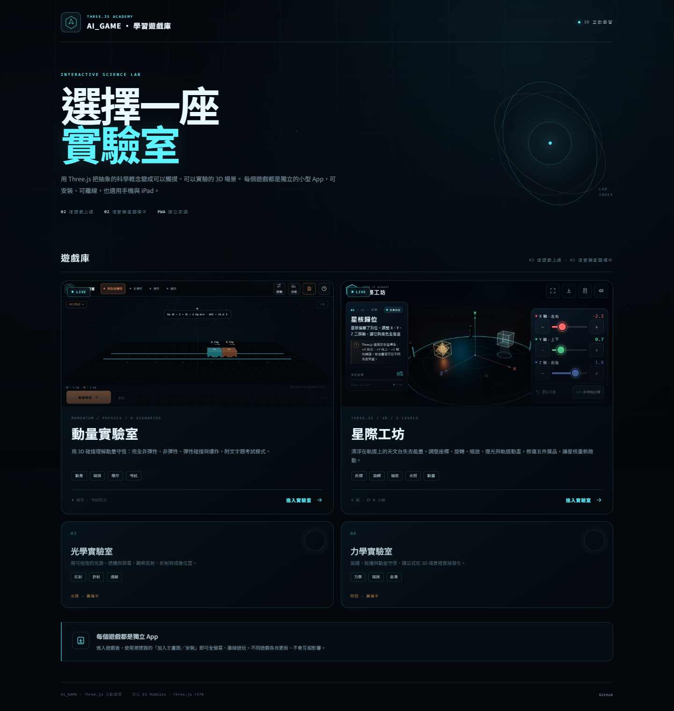

# AI_GAME · 學習遊戲庫

`AI_GAME` 是 Three.js 互動學習遊戲的入口。根目錄是大廳，`games/` 底下每個資料夾都是獨立遊戲、獨立 PWA。

**線上遊戲庫：** <https://lucas151129.github.io/AI_GAME/>



## 遊戲

| 遊戲 | 主題 | 狀態 | 路徑 |
| --- | --- | --- | --- |
| [動量實驗室](games/momentum/) | 動量守恆、碰撞、爆炸、文字題 | 已上線 | `/games/momentum/` |
| [星際工坊](games/starforge/) | 座標、旋轉、縮放、光照、動畫 | 已上線 | `/games/starforge/` |
| 光學實驗室 | 反射、折射、透鏡 | 籌備中 | — |
| 力學實驗室 | 拋體、碰撞、動量 | 籌備中 | — |

## 專案結構

```text
AI_GAME/
├─ index.html                 ← 大廳
├─ hub.css
├─ hub.js
├─ games.json                 ← 遊戲清單
├─ sw.js                      ← 舊版 root PWA 清理用；大廳不註冊 SW
├─ serve.mjs                  ← 本機大廳伺服器
├─ shared/                    ← 未來共用資源
├─ games/
│  ├─ momentum/
│  │  ├─ index.html
│  │  ├─ manifest.webmanifest
│  │  ├─ sw.js
│  │  ├─ src/
│  │  ├─ icons/
│  │  └─ preview-mobile.png
│  ├─ starforge/
│  │  ├─ index.html
│  │  ├─ manifest.webmanifest
│  │  ├─ sw.js
│  │  ├─ src/
│  │  ├─ vendor/
│  │  ├─ icons/
│  │  └─ preview*.png
│  └─ <new-game>/
└─ .nojekyll
```

## 新增遊戲的規則

1. 在 `games/<lowercase-slug>/` 開新資料夾，**不要放在根目錄**。
2. 每個遊戲自帶：
   - `manifest.webmanifest`：`start_url: "./"`、`scope: "./"`
   - `sw.js`：放遊戲資料夾內，cache 名稱要唯一
   - 自己的 `index.html`、assets
3. 在 `games.json` 加入遊戲資料，於大廳顯示卡片。
4. localStorage key 加遊戲前綴，例如 `sf:`、`optics:`；IndexedDB 名稱也要區分。
5. 完成後驗證：
   - `https://lucas151129.github.io/AI_GAME/games/<slug>/`
   - manifest、service worker、離線重新載入
   - 手機與 iPad 橫向

## 每個遊戲都是獨立 PWA

- 星際工坊的 service worker 只在 `/AI_GAME/games/starforge/` 生效。
- 不同遊戲的 cache 名稱不可重複；activate 時只清自己的前綴。
- 大廳本身不安裝、不註冊 service worker；玩家是逐個遊戲安裝。
- 舊版安裝在 `/AI_GAME/` 的星際工坊 PWA 會開啟這個大廳，需重新從 `/games/starforge/` 加入主畫面。根目錄 `sw.js` 只負責清理舊 root cache 並 unregister，不會由大廳註冊。

## 本機預覽

```powershell
node serve.mjs
```

開啟 <http://127.0.0.1:8140>。

個別遊戲：

```powershell
cd games\starforge
node serve.mjs
```

開啟 <http://127.0.0.1:8137>。

> 本機 http 不會註冊 service worker；PWA 離線功能請在 HTTPS 的 GitHub Pages 測試。

## 技術

- Three.js r170（本地 `vendor/`）
- 原生 ES Modules，無打包工具
- GitHub Pages（`main` / root）
- 每個遊戲獨立 manifest、service worker 與 cache
- 繁體中文、手機／iPad／桌面
