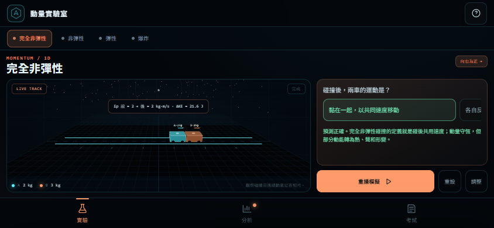

# 動量實驗室 · Momentum Lab

以 **3D 碰撞** 學習高中物理「動量」的互動模擬器。目標不是讓學生看動畫，而是讓學生走完真正的解題流程：

> 選系統 → 定正方向 → 寫動量守恆 → 代入 → 檢查方向與能量去向 → 做文字題。

**線上遊玩：** <https://lucas151129.github.io/AI_GAME/games/momentum/>
**遊戲庫：** <https://lucas151129.github.io/AI_GAME/>



## 四個必考情景

| 情景 | 守恆條件 | 核心公式 |
| --- | --- | --- |
| 完全非彈性 | 動量守恆；碰後共同速度 | `m₁u₁ + m₂u₂ = (m₁ + m₂)v` |
| 非彈性 | 動量守恆；動能不守恆 | `m₁u₁ + m₂u₂ = m₁v₁ + m₂v₂` |
| 彈性 | 動量與動能都守恆 | 動量式 + `½m₁u₁² + ½m₂u₂² = ½m₁v₁² + ½m₂v₂²` |
| 爆炸 | 爆炸前後總動量守恆；動能增加 | `0 = m₁v₁ + m₂v₂`、`E = ½m₁v₁² + ½m₂v₂²` |

## 學習設計

### 1. 先預測，才可模擬

每個情景都有一條概念預測題；未選預測時按「先選預測」會打開控制面板。這是刻意的 **Predict–Observe–Explain** 閘門，避免學生只拖滑桿看熱鬧。

### 2. 動量棒與能量棒同步

右側分析面板同時顯示：

- 帶正負號的動量 `p₁ / p₂ / Σp`：可以抵消，總長度在碰前碰後相同。
- 永遠正值的動能 `KE₁ / KE₂ / ΣKE`：非彈性碰撞後總量下降，爆炸後總量上升。

同一個畫面看到「動量守恆，但動能不守恆」，比背口訣有效。

### 3. 文字題的 marking scheme

「考試模式」不是選擇題，而是文字題訓練：

- 完全非彈性：求共同速度與動能損失
- 非彈性：已知一車碰後速度，求另一車與能量損失
- 彈性：同時求兩個碰後速度
- 爆炸：已知一塊碎片速度，求另一塊與釋放能量

每題提供「提示」與完整 **解題步驟**，順序對應考試得分位：

1. 選系統
2. 取正方向
3. 說明外力可忽略
4. 寫動量守恆（必要時加能量式）
5. 代入數字與單位
6. 補方向
7. 能量差去了哪裡
8. 檢查合理性

### 4. 方向與系統

- 全遊戲固定「向右為正」；向左速度要輸入負數。
- 非彈性／完全非彈性只保證動量守恆；彈性才加動能守恆。
- 爆炸前靜止：總動量為零，但總動能增加，能量來自化學能／彈性能。
- 有牆、摩擦力、繩張力等外力時，不能直接用動量守恆；那些情況要用衝量 `J = FΔt = Δp`。

## 為什麼不用 Rapier 或 Matter.js？

一維碰撞的動量與能量可以用解析公式精確求出；用通用物理引擎反而會引入：

- 碰撞求解器的穿透修正、rest friction、restitution 近似
- 數值誤差，令 `Σp` 與 `ΣKE` 不再乾淨地守恆
- 學生更難把畫面連回 marking scheme

所以這個遊戲用 **Three.js 只做 3D 呈現**，物理核心是固定的 120 Hz 解析碰撞／爆炸計算：

- 位置只作視覺動畫
- 碰後速度、動量、動能、能量損失全部由公式直接計算
- 碰撞時間、方向、總動量都可重現

優點是「畫面看到的數字」與「考試計出的數字」完全一致；若之後要做二維、斜面或滾動，才值得加入 Rapier。

## 技術

- Three.js r170（本地 `vendor/`，無需連網）
- 原生 ES Modules，無打包工具
- 自製 1D 動量／碰撞核心，固定 1/120 秒時間步
- 自己的 `manifest.webmanifest`、`sw.js`、cache `momentum-v1`
- PWA：可獨立安裝、離線載入
- 繁體中文、手機／iPad／桌面
- 手機直向、手機橫向、iPad 直向、iPad 橫向都有獨立版面
- 手機以底部導航（實驗／分析／考試）操作；iPad 橫向自動變成雙欄

## 本機預覽

在 `AI_GAME` 根目錄：

```powershell
node serve.mjs
```

開啟 <http://127.0.0.1:8140/games/momentum/>。

> 本機 http 不會註冊 service worker；PWA 離線功能請在 HTTPS 的 GitHub Pages 測試。

## 專案結構

```text
games/momentum/
├─ index.html
├─ style.css
├─ manifest.webmanifest
├─ sw.js
├─ preview-mobile.png
├─ preview-phone.png
├─ preview-ipad.png
├─ icons/
│  ├─ icon-192.png
│  ├─ icon-512.png
│  ├─ apple-touch-icon.png
│  └─ favicon-32.png
├─ src/
│  ├─ main.js       3D 場景、UI、模擬循環
│  ├─ physics.js    碰撞／爆炸解析核心
│  ├─ scenarios.js  四個情景、預測題、教學文案
│  └─ exam.js       文字題生成與 marking scheme
└─ vendor/
   └─ three.module.js
```

## 教學參考

- PhET Collision Lab：<https://phet.colorado.edu/en/simulations/collision-lab>
- The Physics Classroom — Momentum and Collisions：<https://www.physicsclassroom.com/class/momentum>
- HKEAA Physics 科目資訊：<https://www.hkeaa.edu.hk/en/hkdse/assessment/subject_information/category_a_subjects/phys/>
